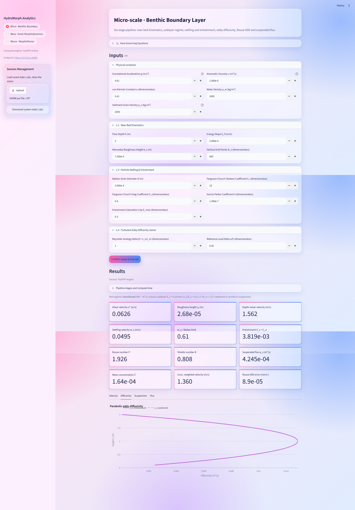
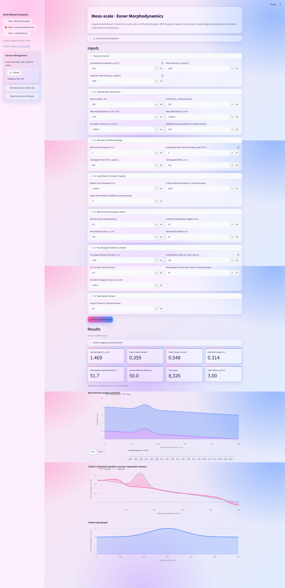
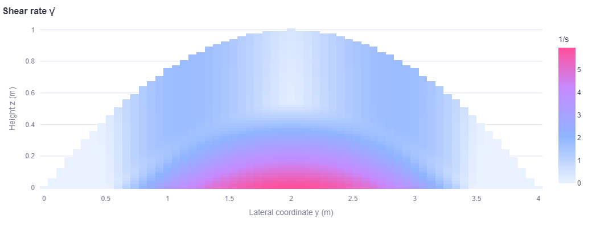
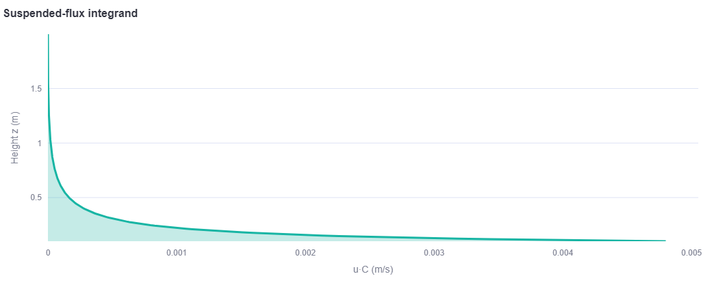
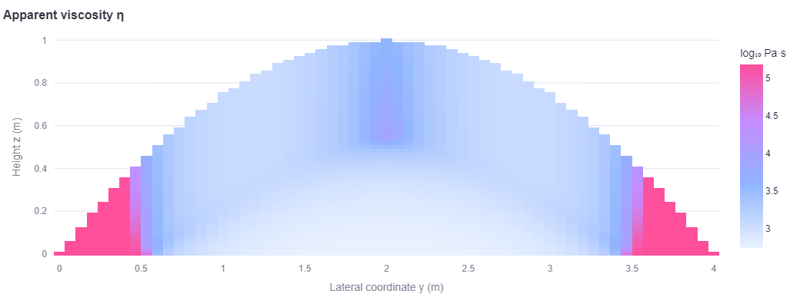
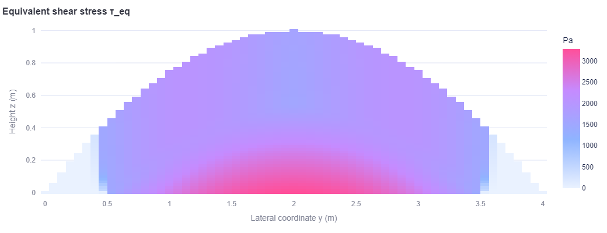
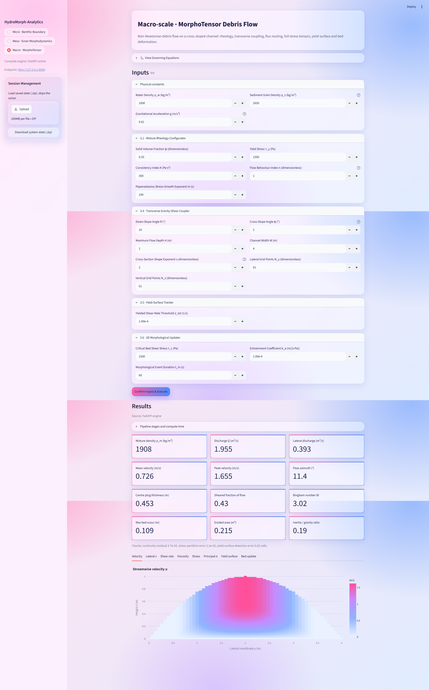
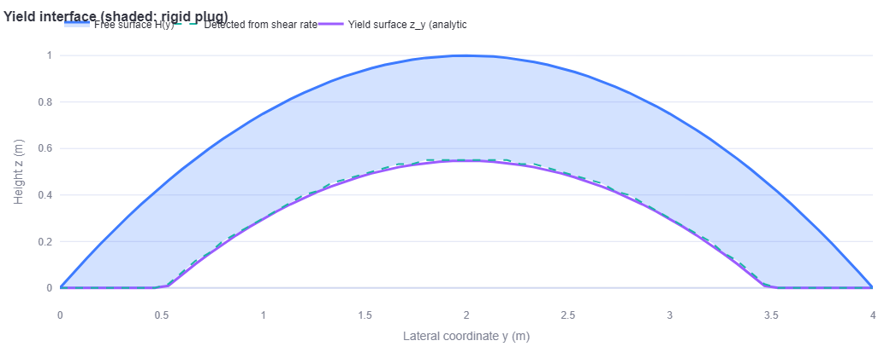

# HydroMorph-Studio

**A Commercial-Grade, Multi-Scale Sediment Transport, Fluvial Morphodynamics, and Non-Newtonian Rheology Suite**

## 1. Executive Overview

**HydroMorph-Studio** (formerly *HydroMorph-Analytics*) is a deterministic hydroinformatics workstation engineered from first-principles continuum mechanics and tensor calculus. Unlike black-box empirical calculators, this suite bridges three distinct physical scales of sediment mechanics within a unified, modular architecture:

1. **Micro-Scale (`Benthic-Boundary Engine`):** 1D vertical boundary-layer kinematics, viscous sublayer diagnostics, turbulent burst entrainment, and analytical/numerical Rouse suspension profiling.
2. **Meso-Scale (`Exner Morphodynamics Engine`):** Coupled 1D Saint-Venant shallow-water hydrodynamics, bedload transport capacity, shock-capturing MacCormack bed evolution, and Courant-Friedrichs-Lewy (CFL) stability management.
3. **Macro-Scale (`MorphoTensor Engine`):** 3D non-Newtonian hyper-concentrated debris flows, Bingham/Herschel-Bulkley viscoplastic stress tensors, yield-surface tracking, and multi-axial finite-volume routing.

## Screenshots

| Dashboard | Micro-Scale |
| :---: | :---: |
|  |  |

| Meso-Scale | Macro-Scale |
| :---: | :---: |
|  |  |

<details>
<summary>Additional plots and workspace views</summary>

| Micro plots | Meso plots |
| :---: | :---: |
|  |  |
|  |  |
|  |  |

| Macro plots | Workspace views |
| :---: | :---: |
|  |  |
|  |  |
|  |  |

</details>

## 2. Core Engineering Philosophy & Hardware Optimization

HydroMorph-Studio is explicitly architected to execute high-precision numerical simulations on baseline hardware (**Intel Core i3 CPU with 8 GB RAM**, zero GPU dependency) while preserving machine-epsilon mass conservation:

* **Strict 0-Loop Spatial Vectorization:** Python `for` loops over spatial grids are strictly prohibited. All spatial gradients, finite-volume fluxes, and numerical integrations utilize contiguous C-level NumPy array slicing, broadcasting, and SciPy ODE/quadrature routines. Outer loops are restricted exclusively to temporal integration ($t^n \rightarrow t^{n+1}$).
* **Decoupled Fault-Tolerant Architecture:** A lightweight **Streamlit** frontend communicates with an asynchronous **FastAPI** compute server (`127.0.0.1:8000`). If the FastAPI server is offline, the frontend automatically falls back to an in-process execution engine without interrupting user workflow.
* **Unbreakable Registry Pattern:** The entry point (`frontend/app.py`) is an immutable thin shell that dynamically resolves modules via `frontend/registry.py`. Adding or modifying physical engines never risks crashing the primary application.
* **Columnar State-Space Persistence:** Simulation outputs and decimated space-time tensors are serialized into compressed binary **Apache Parquet** (`.parquet`) tables via `pyarrow` alongside JSON parameter manifests inside downloadable `.zip` archives, enabling zero-copy state restoration.
* **WebGL Kinematic Offloading:** Transient morphological animations offload frame rendering directly to the browser's WebGL context using locked coordinate bounds (`fixedrange=True`), eliminating CPU re-layout bottlenecks during playback.

## 3. Multi-Scale Physics Architecture & Governing Equations

### Scale I: Micro-Scale — Benthic-Boundary Engine

Resolves the vertical equilibrium between downward gravitational settling and upward turbulent diffusion across the flow depth $z \in [a, h]$.

#### Sequential 6-Submodule Pipeline

* **Sub-module 1.1: Near-Bed Kinematics** — Evaluates basal shear velocity and generates the logarithmic velocity profile.
* **Sub-module 1.2: Viscous Sublayer Diagnostics** — Computes laminar sublayer thickness and classifies hydraulic roughness regimes via the grain Reynolds number.
* **Sub-module 1.3: Particle Settling & Entrainment** — Computes terminal fall velocity and solves the Garcia-Parker near-bed reference concentration $C_a$.
* **Sub-module 1.4: Turbulent Eddy Diffusivity Solver** — Constructs the vertical parabolic momentum/mass diffusivity distribution under the Reynolds analogy.
* **Sub-module 1.5: Suspension ODE Integrator** — Solves the 1D steady-state advection-diffusion ordinary differential equation alongside the exact analytical Rouse profile.
* **Sub-module 1.6: Macroscopic Flux Aggregator** — Performs vectorized numerical quadrature over the product of velocity and concentration fields.

#### Governing Formulations

**Shear Velocity & Viscous Sublayer Thickness**

```math
u_* = \sqrt{\frac{\tau_b}{\rho_w}}, \qquad
\delta_v = 11.6\,\frac{\nu}{u_*}, \qquad
Re_* = \frac{u_* k_s}{\nu}
```

**Prandtl–von Kármán Law of the Wall**

```math
u(z) = \frac{u_*}{\kappa}\,\ln\!\left(\frac{z}{z_0}\right)
```

**Garcia–Parker Entrainment & Reference Concentration** ($z = a = 0.05h$)

```math
R_p = \frac{\sqrt{R_g\, g\, d_{50}}\, d_{50}}{\nu}, \qquad
Z_u = \frac{u_*}{w_s}\,R_p^{0.6}, \qquad
C_a = E_s = \frac{A Z_u^5}{1 + \frac{A}{0.3}\,Z_u^5}
```

where $A = 1.3 \times 10^{-7}$ and $R_g = (\rho_s - \rho_w)/\rho_w$. This implementation uses the total shear velocity $u_*$ in $Z_u$ under a *flat-bed / plane-bed assumption* ($u_*' = u_*$, negligible bedform drag).

**Parabolic Turbulent Diffusivity & Advection–Diffusion Balance**

```math
\varepsilon_s(z) = \kappa\, u_*\, z \left(1 - \frac{z}{h}\right), \qquad
w_s\, C(z) + \varepsilon_s(z)\,\frac{dC}{dz} = 0
```

**Rouse Analytical Suspension Profile & Depth-Integrated Flux**

```math
\frac{C(z)}{C_a} = \left(\frac{h-z}{z}\cdot\frac{a}{h-a}\right)^{Ro}, \qquad
Ro = \frac{w_s}{\kappa\, u_*}, \qquad
q_{ss} = \int_{a}^{h} u(z)\,C(z)\,dz
```

### Scale II: Meso-Scale — Exner Morphodynamics Engine

Simulates longitudinal riverbed aggradation, degradation, and bedform migration along a 1D spatial domain $x \in [0, L]$ over morphological time $t$.

#### Sequential 6-Submodule Pipeline

* **Sub-module 2.1: Hydrodynamic State Solver** — Evaluates quasi-steady 1D Saint-Venant depth, velocity, and free-surface elevation profiles.
* **Sub-module 2.2: Boundary Condition Manager** — Enforces ghost-cell padding, upstream equilibrium sediment supply, and downstream stage conditions.
* **Sub-module 2.3: Basal Shear & Transport Capacity Engine** — Computes local bed shear stress, dimensionless Shields stress, and Meyer-Peter Müller bedload flux.
* **Sub-module 2.4: Bed-Evolution Divergence Solver** — Integrates the 1D Exner conservation law via a shock-capturing MacCormack predictor-corrector finite-volume scheme and audits relative mass-balance error down to $O(10^{-15})$.
* **Sub-module 2.5: Morphological Stability Controller** — Dynamically regulates $\Delta t$ via hydraulic and morphological CFL criteria and applies the Morphological Acceleration Factor ($M_f$).
* **Sub-module 2.6: State-Space Persister** — Decimates temporal frames for WebGL playback and packages `.parquet` state tensors into `.zip` bundles.

### Scale III: Macro-Scale — MorphoTensor Engine (3D Debris & Mudflow Rheology)

Models hyperconcentrated non-Newtonian mudflows and yield-stress continuum mechanics.

#### Sequential 6-Submodule Pipeline

* **Sub-module 3.1 — Mixture Rheology Configurator:** Defines Bingham Plastic and Herschel–Bulkley yield stress ($\tau_y$), consistency ($K$), and power-law index ($n_r$).
* **Sub-module 3.2 — 3D Stress Tensor Generator:** Partitions isotropic pressure and deviatoric viscous stress tensors ($\sigma_{ij}$) using regularized second invariants of the strain-rate tensor ($II_D$).
* **Sub-module 3.3 — Non-Newtonian Flux Router:** Computes vectorized 3D mass and momentum flux divergence across variable topography.
* **Sub-module 3.4 — Transverse Gravity–Shear Coupler:** Resolves bi-directional slope gravity driving forces against basal and internal shear resistance.
* **Sub-module 3.5 — Yield-Surface Tracker:** Identifies the dynamic interface ($h_p$) separating the upper rigid plug-flow zone ($|\tau| \le \tau_y$) from the lower sheared zone ($|\tau| > \tau_y$).
* **Sub-module 3.6 — 3D Morphological Updater:** Updates volumetric deposition and erosion fields across the macroscopic domain.

---

## 4. Governing Continuum Equations

### I. Micro-Scale (`Benthic-Boundary`)

| Physical Mechanism | Governing Formulation | Key Variables & SI Units |
| :--- | :--- | :--- |
| **Law of the Wall** | $$u(z)=\frac{u_*}{\kappa}\ln\!\left(\frac{z}{z_0}\right)$$ | $u_*$: shear velocity (m/s), $\kappa$: von Kármán constant (-), $z_0$: roughness height (m) |
| **Shear Reynolds & Sublayer** | $$Re_*=\frac{u_* k_s}{\nu},\qquad \delta_v=11.6\,\frac{\nu}{u_*}$$ | $k_s$: Nikuradse roughness (m), $\nu$: kinematic viscosity (m²/s), $\delta_v$: viscous sublayer (m) |
| **Garcia–Parker Entrainment** | $$E_s=\frac{A Z_u^5}{1+\frac{A}{0.3}Z_u^5},\qquad Z_u=\frac{u_*}{w_s}R_p^{0.6},\qquad R_p=\frac{\sqrt{R_g g d_{50}}\,d_{50}}{\nu}$$ | $A=1.3\times10^{-7}$, $R_g=(\rho_s-\rho_w)/\rho_w$, $Z_u$: similarity variable (-), $C_a=E_s$: reference concentration (-); flat-bed / plane-bed assumption ($u_*'=u_*$) |
| **Parabolic Eddy Diffusivity** | $$\varepsilon_s(z)=\kappa\,u_*\,z\left(1-\frac{z}{h}\right)$$ | $\varepsilon_s$: turbulent sediment diffusivity (m²/s), $h$: flow depth (m) |
| **Suspension Advection–Diffusion** | $$w_s C(z)+\varepsilon_s(z)\,\frac{dC}{dz}=0$$ | $C(z)$: volumetric concentration (-), $w_s$: terminal settling velocity (m/s) |
| **Rouse Analytical Profile** | $$\frac{C(z)}{C_a}=\left(\frac{h-z}{z}\cdot\frac{a}{h-a}\right)^{Ro},\qquad Ro=\frac{w_s}{\kappa u_*}$$ | $Ro$: Rouse number (-), $a$: reference level (m) |
| **Macroscopic Suspended Flux** | $$q_{ss}=\int_{a}^{h}u(z)\,C(z)\,dz$$ | $q_{ss}$: depth-integrated volumetric suspended sediment transport rate (m²/s) |

### II. Meso-Scale (`Exner Morphodynamics`)

| Physical Mechanism | Governing Formulation | Key Variables & SI Units |
| :--- | :--- | :--- |
| **Saint-Venant Continuity** | $$\frac{\partial h}{\partial t}+\frac{\partial(hu)}{\partial x}=0$$ | $h$: water depth (m), $u$: depth-averaged velocity (m/s), $t$: time (s), $x$: streamwise coordinate (m) |
| **Saint-Venant Momentum** | $$\frac{\partial(hu)}{\partial t}+\frac{\partial}{\partial x}\!\left(hu^2+\tfrac{1}{2}gh^2\right)=g h(S_0-S_f)$$ | $g$: gravity (m/s²), $S_0=-\partial z_b/\partial x$: bed slope (-), $S_f=\frac{n^2u\lvert u\rvert}{h^{4/3}}$: friction slope (-) |
| **Shields Parameter** | $$\theta=\frac{\tau_b}{(\rho_s-\rho_w)g d_{50}}$$ | $\tau_b=\rho_w g h S_f$: basal shear (Pa), $\rho_s,\rho_w$: sediment/water density (kg/m³), $d_{50}$: median grain (m) |
| **Meyer-Peter & Müller Flux** | $$q_b=\alpha_{\mathrm{mpm}}\sqrt{(s-1)g d_{50}^3}\,\max(0,\theta-\theta_c)^{\beta_{\mathrm{mpm}}}$$ | $q_b$: volumetric bedload (m²/s), $s=\rho_s/\rho_w$, $\theta_c$: critical Shields (-) |
| **Exner Conservation PDE** | $$(1-\lambda_p)\frac{\partial z_b}{\partial t}+M_f\frac{\partial q_b}{\partial x}=0$$ | $z_b$: bed elevation (m), $\lambda_p$: bed porosity (-), $M_f$: morphological acceleration factor (-) |
| **MacCormack Predictor** | $$z_{b,i}^{*}=z_{b,i}^{n}-\frac{M_f\Delta t}{(1-\lambda_p)\Delta x}\left(q_{b,i+1}^{n}-q_{b,i}^{n}\right)$$ | Forward finite-difference predictor, grid spacing $\Delta x$ (m) |
| **MacCormack Corrector** | $$z_{b,i}^{n+1}=\tfrac{1}{2}\!\left[z_{b,i}^{n}+z_{b,i}^{*}-\frac{M_f\Delta t}{(1-\lambda_p)\Delta x}\left(q_{b,i}^{*}-q_{b,i-1}^{*}\right)\right]+D_{\mathrm{art}}$$ | Backward corrector with TVD artificial viscosity $D_{\mathrm{art}}$ |
| **CFL Stability Criterion** | $$\Delta t=\mathrm{CFL}\,\frac{\Delta x}{\max\!\left(\lvert u\rvert+\sqrt{gh},\,c_m\right)}$$ | $\mathrm{CFL}\le 1$, $c_m$: bedform celerity (m/s), $\Delta t$: stable time step (s) |

### III. Macro-Scale (`MorphoTensor` 3D Rheology)

| Physical Mechanism | Governing Formulation | Key Variables & SI Units |
| :--- | :--- | :--- |
| **Herschel–Bulkley Law** | $$\tau=\tau_y+K\,\dot{\gamma}^{n_r},\qquad (\lvert\tau\rvert>\tau_y)$$ | $\tau_y$: yield stress (Pa), $K$: consistency index (Pa·s$^{n_r}$), $n_r$: flow index (-), $\dot{\gamma}$: shear rate (s⁻¹) |
| **3D Cauchy Stress Tensor** | $$\sigma_{ij}=-p\,\delta_{ij}+2\,\eta_{\mathrm{eff}}(II_D)\,D_{ij}$$ | $p$: isotropic pressure (Pa), $\delta_{ij}$: Kronecker delta, $D_{ij}=\tfrac{1}{2}(\partial u_i/\partial x_j+\partial u_j/\partial x_i)$ |
| **Regularized Viscosity** | $$\eta_{\mathrm{eff}}=K\,\lvert II_D\rvert^{(n_r-1)/2}+\frac{\tau_y}{2\sqrt{\lvert II_D\rvert}+\varepsilon_{\mathrm{reg}}}$$ | $II_D=\tfrac{1}{2}(D_{ij}D_{ij})$: second invariant (s⁻²), $\varepsilon_{\mathrm{reg}}$: Papanastasiou regularizer (s⁻¹) |
| **Yield-Surface Plug Depth** | $$h_p=\frac{\tau_y}{\rho_m g\sin\alpha}$$ | $h_p$: rigid plug-flow thickness (m), $\rho_m$: mixture density (kg/m³), $\alpha$: terrain inclination (rad) |

---

## 5. Repository Structure

```text
HydroMorph-Studio/
│
├── frontend/
│   ├── app.py                              # Fault-tolerant Streamlit entry shell
│   ├── registry.py                         # Central model dictionary & lazy-loading router
│   ├── components/
│   │   ├── api_client.py                   # FastAPI HTTP client with in-process fallback
│   │   ├── persistence.py                  # State snapshot/restore utilities
│   │   ├── plots.py                        # Plotly styling & scientific plotting helpers
│   │   ├── theme.py                        # UI theme/CSS injection
│   │   └── workflow.py                     # Shared input/render/workflow helpers
│   └── views/
│       ├── view_micro_benthic.py           # Micro-Scale UI
│       ├── view_meso_exner.py              # Meso-Scale UI (WebGL animation/export)
│       └── view_macro_tensor.py            # Macro-Scale UI
│
├── core/
│   ├── base_model.py                       # SubModule/BaseModel contracts, validation, packing
│   └── physics_constants.py                # Default physical constants exposed as inputs
│
├── backend/
│   ├── main.py                             # FastAPI application server
│   ├── api_registry.py                     # Model registry & /api routes
│   └── engines/
│       ├── micro_engine.py                 # Sub-modules 1.1–1.6 (vectorized 1D vertical)
│       ├── meso_engine.py                  # Sub-modules 2.1–2.6 (MacCormack/Exner time march)
│       └── macro_engine.py                 # Sub-modules 3.1–3.6 (3D rheology/tensor pipeline)
│
├── requirements.txt
├── run_hydromorph.py
├── start_studio.bat
└── README.md
```

## 6. UI/UX & Visualization Standards

* **Pink & Blue Glassmorphism:** Frosted translucent containers (`backdrop-filter: blur(12px)`), soft radial gradients, and fully transparent Plotly canvases (`paper_bgcolor='rgba(0,0,0,0)'`, `plot_bgcolor='rgba(0,0,0,0)'`).
* **Zero-Slider Policy & Explicit SI Units:** Sliders (`st.slider`) are strictly banned to prevent accidental continuous re-computation. Every parameter uses `st.number_input` with explicit SI units in the label and zero hardcoded physical constants.
* **Instant Physical Validation & Confirmation Gate:** Out-of-bounds physical values trigger immediate blocking `st.error()` alerts. Simulations execute strictly upon clicking **Confirm Inputs & Execute**.
* **Engineering Graph Formatting:** Log-scale axes enforce power-of-ten scientific notation ($10^{-4}, 10^{-3}$), initial-vs-final bed comparisons feature volumetric `fill='tonexty'` shading, and state export tools are housed inside a dedicated **Session Management** container.

## 7. Installation & Execution

### Prerequisites

* Python $3.10+$
* Git

### 1. Clone the Repository

```bash
git clone https://github.com/saunakbanerjee484-byte/HydroMorph-Studio.git
cd HydroMorph-Studio
```

### 2. Create & Activate a Virtual Environment

```bash
# Windows (PowerShell)
python -m venv .venv
.\.venv\Scripts\Activate.ps1

# Linux / macOS
python3 -m venv .venv
source .venv/bin/activate
```

### 3. Install Dependencies

```bash
pip install -r requirements.txt
```

### 4. Launch the Suite

**Option A: Full Decoupled Mode (FastAPI Backend + Streamlit Frontend)**

Open two terminals from the project root:

*Terminal 1 — Start the FastAPI Compute Engine:*

```bash
python -m uvicorn backend.main:app --host 127.0.0.1 --port 8000 --reload
```

*Terminal 2 — Start the Streamlit Workstation:*

```bash
python -m streamlit run frontend/app.py
```

**Option B: Standalone In-Process Mode**

Simply launch the Streamlit app; it will automatically detect that port `8000` is offline and execute all vectorized NumPy/SciPy pipelines directly in-process:

```bash
python -m streamlit run frontend/app.py
```

**Option C: Unified Launcher**

```bash
python run_hydromorph.py
```

## 8. Numerical Notes and Limits

* **Meso:** MacCormack with Jameson-type smoothing; Riemann-invariant ghost cells; subcritical flow only (Fr < 0.95); rating-curve outflow. Exner is a finite-volume Forward Euler update with upwind face fluxes and MPM capacity; dynamic MorFac caps bed change per step. Sediment mass error is reported.
* **Macro:** Steady uniform flow with a local-depth approximation. The tangential-gravity direction fixes the shear-stress direction, so a cross-slope drives lateral flow (wall blockage ignored); vertical velocity comes from continuity. The plug shears laterally, so yielding is detected from vertical shear. 3.6 is a scour-only excess-shear entrainment law, not a full topology solver.
* **Micro:** $z_0 = 0.11\nu/u_* + k_s/30$ holds in all regimes; 1.2 classifies the regime from $Re_*$.

## 9. Adding a Model

Subclass `SubModule`/`BaseModel` in `backend/engines/`, register in `backend/api_registry.py`, add a view in `frontend/views/`, and add one line in `frontend/registry.py`.

## 10. Author & License

Developed by **Saunak Banerjee** — Repository: [HydroMorph-Studio](https://github.com/saunakbanerjee484-byte/HydroMorph-Studio)
