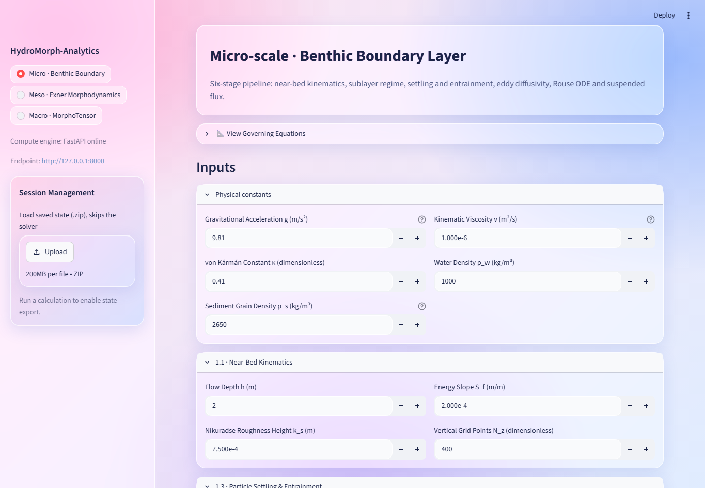
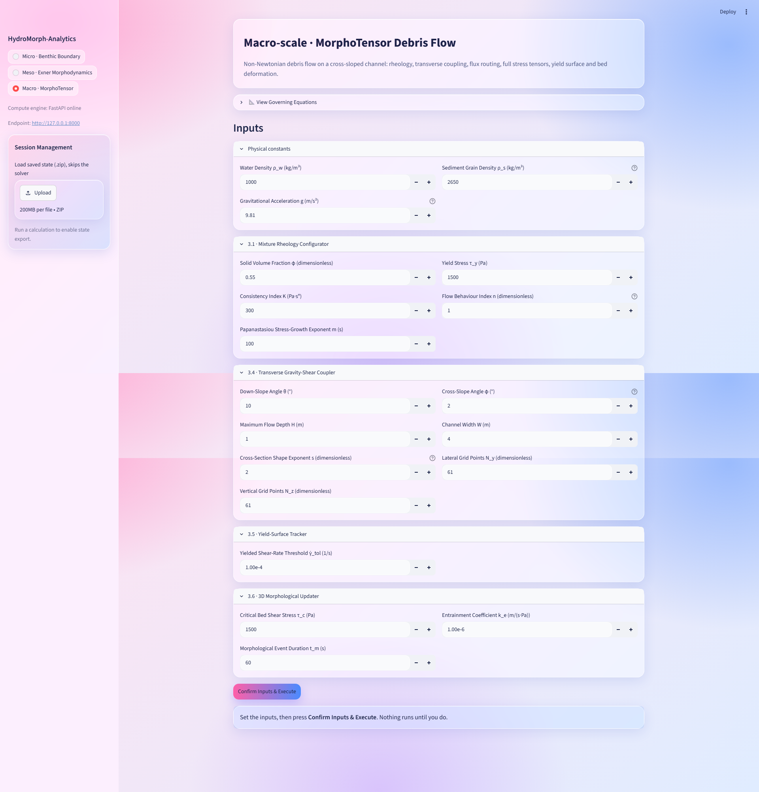
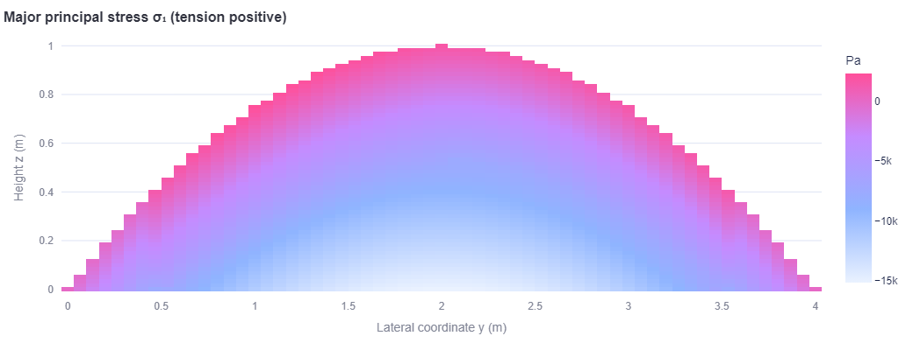
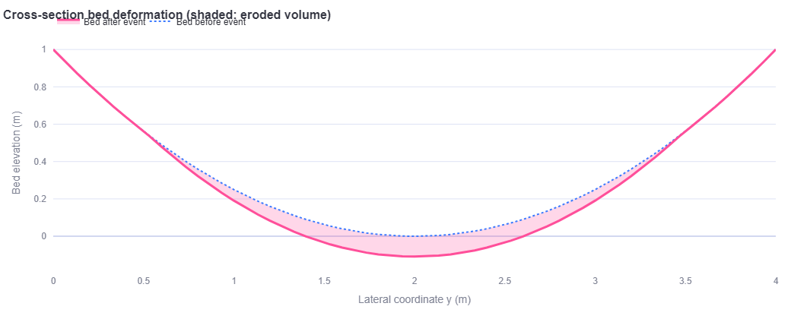

<div align="center">

# HydroMorph-Studio

### Commercial-Grade Multi-Scale Sediment Transport, Fluvial Morphodynamics & Non-Newtonian Rheology

[](https://www.python.org/)
[](https://streamlit.io/)
[](https://fastapi.tiangolo.com/)
[](https://numpy.org/)
[](#10-author--license)

*A deterministic hydroinformatics workstation bridging micro-scale boundary-layer physics, meso-scale riverbed morphodynamics, and macro-scale debris-flow rheology — engineered from first principles.*

[Overview](#1-executive-overview) · [Screenshots](#screenshots) · [Architecture](#3-multi-scale-physics-architecture--governing-equations) · [Equations](#4-governing-continuum-equations) · [Quick Start](#7-installation--execution) · [Repository](#5-repository-structure)

</div>

---

## At a Glance

| | Micro | Meso | Macro |
| :--- | :--- | :--- | :--- |
| **Engine** | `Benthic-Boundary` | `Exner Morphodynamics` | `MorphoTensor` |
| **Physics** | Boundary layer, settling, Rouse suspension | Saint-Venant + Exner bed evolution | Herschel–Bulkley / Bingham rheology |
| **Domain** | 1D vertical $z \in [a,h]$ | 1D longitudinal $x \in [0,L], t$ | 3D tensorial flow field |
| **Pipeline** | 6 sequential sub-modules | 6 coupled sub-modules in time march | 6 dependency-ordered sub-modules |
| **Key Output** | $u(z), C(z), q_{ss}$ | $h, u, z_b, \Delta z_b$, mass error | $\tau_{ij}, h_p$, yield/plastic zones |

> [!TIP]
> **Built for real hardware constraints.** HydroMorph-Studio is designed to run high-fidelity numerical simulations on baseline machines (**Intel Core i3, 8 GB RAM, no GPU**) with strict 0-loop spatial vectorization and machine-epsilon mass-conservation auditing.

---

## 1. Executive Overview

**HydroMorph-Studio** (formerly *HydroMorph-Analytics*) is a deterministic hydroinformatics workstation engineered from first-principles continuum mechanics and tensor calculus. Unlike black-box empirical calculators, it unifies three distinct physical scales of sediment mechanics in one modular architecture:

<table>
<tr>
<td width="33%" valign="top">

### 🔬 Micro-Scale
**Benthic-Boundary Engine**

1D vertical boundary-layer kinematics, viscous sublayer diagnostics, turbulent burst entrainment, and analytical/numerical Rouse suspension profiling.

</td>
<td width="33%" valign="top">

### 🌊 Meso-Scale
**Exner Morphodynamics Engine**

Coupled 1D Saint-Venant shallow-water hydrodynamics, bedload transport capacity, shock-capturing MacCormack bed evolution, and CFL stability management.

</td>
<td width="33%" valign="top">

### 🧱 Macro-Scale
**MorphoTensor Engine**

3D non-Newtonian hyper-concentrated debris flows, Bingham/Herschel–Bulkley viscoplastic stress tensors, yield-surface tracking, and multi-axial routing.

</td>
</tr>
</table>

---

## Screenshots

<div align="center">

| Dashboard | Micro-Scale |
| :---: | :---: |
|  |  |

| Meso-Scale | Macro-Scale |
| :---: | :---: |
|  |  |

</div>

<details>
<summary><strong>📸 Additional plots and workspace views</strong></summary>
<br/>

| Micro plots | Meso plots |
| :---: | :---: |
|  |  |
|  |  |
|  |  |

| Macro plots | Workspace views |
| :---: | :---: |
|  |  |
|  |  |
|  |  |

</details>

---

## 2. Core Engineering Philosophy & Hardware Optimization

HydroMorph-Studio is explicitly architected to execute high-precision numerical simulations on baseline hardware (**Intel Core i3 CPU with 8 GB RAM**, zero GPU dependency) while preserving machine-epsilon mass conservation.

| Principle | Implementation |
| :--- | :--- |
| **0-Loop Spatial Vectorization** | Python `for` loops over spatial grids are prohibited. Spatial gradients, finite-volume fluxes, and numerical integrations use contiguous NumPy slicing, broadcasting, `einsum`, and vectorized routines. Outer loops are restricted to temporal integration ($t^n \rightarrow t^{n+1}$). |
| **Decoupled Fault-Tolerant Architecture** | A lightweight **Streamlit** frontend talks to an async **FastAPI** compute server (`127.0.0.1:8000`). If the API is offline, the UI falls back to in-process execution without interrupting workflow. |
| **Unbreakable Registry Pattern** | `frontend/app.py` is a thin shell that resolves modules via `frontend/registry.py`. Adding/modifying engines does not require changing the app shell. |
| **Columnar State-Space Persistence** | Outputs and decimated space-time tensors are serialized as compressed `.npz`/Parquet artifacts with JSON manifests inside downloadable `.zip` archives for zero-copy-style state restoration. |
| **WebGL Kinematic Offloading** | Transient morphological animations offload frame rendering to the browser WebGL context with locked coordinate bounds (`fixedrange=True`), avoiding CPU relayout bottlenecks. |

---

## 3. Multi-Scale Physics Architecture & Governing Equations

### Scale I: Micro-Scale — Benthic-Boundary Engine

Resolves the vertical equilibrium between downward gravitational settling and upward turbulent diffusion across the flow depth $z \in [a, h]$.

#### Sequential 6-Submodule Pipeline

| Sub-module | Responsibility |
| :--- | :--- |
| **1.1 Near-Bed Kinematics** | Evaluates basal shear velocity and generates the logarithmic velocity profile. |
| **1.2 Viscous Sublayer Diagnostics** | Computes laminar sublayer thickness and classifies hydraulic roughness regimes via grain Reynolds number. |
| **1.3 Particle Settling & Entrainment** | Computes terminal fall velocity and solves Garcia–Parker near-bed reference concentration $C_a$. |
| **1.4 Turbulent Eddy Diffusivity Solver** | Constructs vertical parabolic momentum/mass diffusivity distribution under Reynolds analogy. |
| **1.5 Suspension ODE Integrator** | Solves steady 1D advection–diffusion ODE alongside the exact analytical Rouse profile. |
| **1.6 Macroscopic Flux Aggregator** | Performs vectorized numerical quadrature over $u(z)C(z)$ for depth-integrated suspended flux. |

#### Governing Formulations

**Shear Velocity & Viscous Sublayer Thickness**

```math
u_* = \sqrt{\frac{\tau_b}{\rho_w}}, \qquad
\delta_v = 11.6\,\frac{\nu}{u_*}, \qquad
Re_* = \frac{u_* k_s}{\nu}
```

**Prandtl–von Kármán Law of the Wall**

```math
u(z) = \frac{u_*}{\kappa}\,\ln\!\left(\frac{z}{z_0}\right)
```

**Garcia–Parker Entrainment & Reference Concentration** ($z = a = 0.05h$)

```math
R_p = \frac{\sqrt{R_g\, g\, d_{50}}\, d_{50}}{\nu}, \qquad
Z_u = \frac{u_*}{w_s}\,R_p^{0.6}, \qquad
C_a = E_s = \frac{A Z_u^5}{1 + \frac{A}{0.3}\,Z_u^5}
```

where $A = 1.3 \times 10^{-7}$ and $R_g = (\rho_s - \rho_w)/\rho_w$. This implementation uses the total shear velocity $u_*$ in $Z_u$ under a *flat-bed / plane-bed assumption* ($u_*' = u_*$, negligible bedform drag).

**Parabolic Turbulent Diffusivity & Advection–Diffusion Balance**

```math
\varepsilon_s(z) = \kappa\, u_*\, z \left(1 - \frac{z}{h}\right), \qquad
w_s\, C(z) + \varepsilon_s(z)\,\frac{dC}{dz} = 0
```

**Rouse Analytical Suspension Profile & Depth-Integrated Flux**

```math
\frac{C(z)}{C_a} = \left(\frac{h-z}{z}\cdot\frac{a}{h-a}\right)^{Ro}, \qquad
Ro = \frac{w_s}{\kappa\, u_*}, \qquad
q_{ss} = \int_{a}^{h} u(z)\,C(z)\,dz
```

### Scale II: Meso-Scale — Exner Morphodynamics Engine

Simulates longitudinal riverbed aggradation, degradation, and bedform migration along a 1D spatial domain $x \in [0, L]$ over morphological time $t$.

#### Sequential 6-Submodule Pipeline

| Sub-module | Responsibility |
| :--- | :--- |
| **2.1 Hydrodynamic State Solver** | Evaluates quasi-steady 1D Saint-Venant depth, velocity, and free-surface elevation profiles. |
| **2.2 Boundary Condition Manager** | Enforces ghost-cell padding, upstream equilibrium sediment supply, and downstream stage conditions. |
| **2.3 Basal Shear & Transport Capacity Engine** | Computes bed shear stress, dimensionless Shields stress, and Meyer-Peter Müller bedload flux. |
| **2.4 Bed-Evolution Divergence Solver** | Integrates 1D Exner conservation via shock-capturing MacCormack predictor–corrector finite-volume scheme; audits relative mass-balance error. |
| **2.5 Morphological Stability Controller** | Dynamically regulates $\Delta t$ via hydraulic/morphological CFL criteria and applies Morphological Acceleration Factor ($M_f$). |
| **2.6 State-Space Persister** | Decimates temporal frames for WebGL playback and packages `.parquet`/state tensors into `.zip` bundles. |

### Scale III: Macro-Scale — MorphoTensor Engine (3D Debris & Mudflow Rheology)

Models hyperconcentrated non-Newtonian mudflows and yield-stress continuum mechanics.

#### Sequential 6-Submodule Pipeline

| Sub-module | Responsibility |
| :--- | :--- |
| **3.1 Mixture Rheology Configurator** | Defines Bingham Plastic / Herschel–Bulkley yield stress ($\tau_y$), consistency ($K$), and flow index ($n_r$). |
| **3.2 3D Stress Tensor Generator** | Partitions isotropic pressure and deviatoric viscous stress tensors ($\sigma_{ij}$) using regularized strain-rate invariants ($II_D$). |
| **3.3 Non-Newtonian Flux Router** | Computes vectorized 3D mass and momentum flux divergence across variable topography. |
| **3.4 Transverse Gravity–Shear Coupler** | Resolves bi-directional slope gravity driving forces against basal and internal shear resistance. |
| **3.5 Yield-Surface Tracker** | Identifies dynamic interface ($h_p$) separating rigid plug-flow zone ($|\tau| \le \tau_y$) from sheared zone ($|\tau| > \tau_y$). |
| **3.6 3D Morphological Updater** | Updates volumetric deposition and erosion fields across the macroscopic domain. |

---

## 4. Governing Continuum Equations

### I. Micro-Scale (`Benthic-Boundary`)

| Physical Mechanism | Governing Formulation | Key Variables & SI Units |
| :--- | :--- | :--- |
| **Law of the Wall** | $$u(z)=\frac{u_*}{\kappa}\ln\!\left(\frac{z}{z_0}\right)$$ | $u_*$: shear velocity (m/s), $\kappa$: von Kármán constant (-), $z_0$: roughness height (m) |
| **Shear Reynolds & Sublayer** | $$Re_*=\frac{u_* k_s}{\nu},\qquad \delta_v=11.6\,\frac{\nu}{u_*}$$ | $k_s$: Nikuradse roughness (m), $\nu$: kinematic viscosity (m²/s), $\delta_v$: viscous sublayer (m) |
| **Garcia–Parker Entrainment** | $$E_s=\frac{A Z_u^5}{1+\frac{A}{0.3}Z_u^5},\qquad Z_u=\frac{u_*}{w_s}R_p^{0.6},\qquad R_p=\frac{\sqrt{R_g g d_{50}}\,d_{50}}{\nu}$$ | $A=1.3\times10^{-7}$, $R_g=(\rho_s-\rho_w)/\rho_w$, $Z_u$: similarity variable (-), $C_a=E_s$: reference concentration (-); flat-bed / plane-bed assumption ($u_*'=u_*$) |
| **Parabolic Eddy Diffusivity** | $$\varepsilon_s(z)=\kappa\,u_*\,z\left(1-\frac{z}{h}\right)$$ | $\varepsilon_s$: turbulent sediment diffusivity (m²/s), $h$: flow depth (m) |
| **Suspension Advection–Diffusion** | $$w_s C(z)+\varepsilon_s(z)\,\frac{dC}{dz}=0$$ | $C(z)$: volumetric concentration (-), $w_s$: terminal settling velocity (m/s) |
| **Rouse Analytical Profile** | $$\frac{C(z)}{C_a}=\left(\frac{h-z}{z}\cdot\frac{a}{h-a}\right)^{Ro},\qquad Ro=\frac{w_s}{\kappa u_*}$$ | $Ro$: Rouse number (-), $a$: reference level (m) |
| **Macroscopic Suspended Flux** | $$q_{ss}=\int_{a}^{h}u(z)\,C(z)\,dz$$ | $q_{ss}$: depth-integrated volumetric suspended sediment transport rate (m²/s) |

### II. Meso-Scale (`Exner Morphodynamics`)

| Physical Mechanism | Governing Formulation | Key Variables & SI Units |
| :--- | :--- | :--- |
| **Saint-Venant Continuity** | $$\frac{\partial h}{\partial t}+\frac{\partial(hu)}{\partial x}=0$$ | $h$: water depth (m), $u$: depth-averaged velocity (m/s), $t$: time (s), $x$: streamwise coordinate (m) |
| **Saint-Venant Momentum** | $$\frac{\partial(hu)}{\partial t}+\frac{\partial}{\partial x}\!\left(hu^2+\tfrac{1}{2}gh^2\right)=g h(S_0-S_f)$$ | $g$: gravity (m/s²), $S_0=-\partial z_b/\partial x$: bed slope (-), $S_f=\frac{n^2u\lvert u\rvert}{h^{4/3}}$: friction slope (-) |
| **Shields Parameter** | $$\theta=\frac{\tau_b}{(\rho_s-\rho_w)g d_{50}}$$ | $\tau_b=\rho_w g h S_f$: basal shear (Pa), $\rho_s,\rho_w$: sediment/water density (kg/m³), $d_{50}$: median grain (m) |
| **Meyer-Peter & Müller Flux** | $$q_b=\alpha_{\mathrm{mpm}}\sqrt{(s-1)g d_{50}^3}\,\max(0,\theta-\theta_c)^{\beta_{\mathrm{mpm}}}$$ | $q_b$: volumetric bedload (m²/s), $s=\rho_s/\rho_w$, $\theta_c$: critical Shields (-) |
| **Exner Conservation PDE** | $$(1-\lambda_p)\frac{\partial z_b}{\partial t}+M_f\frac{\partial q_b}{\partial x}=0$$ | $z_b$: bed elevation (m), $\lambda_p$: bed porosity (-), $M_f$: morphological acceleration factor (-) |
| **MacCormack Predictor** | $$z_{b,i}^{*}=z_{b,i}^{n}-\frac{M_f\Delta t}{(1-\lambda_p)\Delta x}\left(q_{b,i+1}^{n}-q_{b,i}^{n}\right)$$ | Forward finite-difference predictor, grid spacing $\Delta x$ (m) |
| **MacCormack Corrector** | $$z_{b,i}^{n+1}=\tfrac{1}{2}\!\left[z_{b,i}^{n}+z_{b,i}^{*}-\frac{M_f\Delta t}{(1-\lambda_p)\Delta x}\left(q_{b,i}^{*}-q_{b,i-1}^{*}\right)\right]+D_{\mathrm{art}}$$ | Backward corrector with TVD artificial viscosity $D_{\mathrm{art}}$ |
| **CFL Stability Criterion** | $$\Delta t=\mathrm{CFL}\,\frac{\Delta x}{\max\!\left(\lvert u\rvert+\sqrt{gh},\,c_m\right)}$$ | $\mathrm{CFL}\le 1$, $c_m$: bedform celerity (m/s), $\Delta t$: stable time step (s) |

### III. Macro-Scale (`MorphoTensor` 3D Rheology)

| Physical Mechanism | Governing Formulation | Key Variables & SI Units |
| :--- | :--- | :--- |
| **Herschel–Bulkley Law** | $$\tau=\tau_y+K\,\dot{\gamma}^{n_r},\qquad (\lvert\tau\rvert>\tau_y)$$ | $\tau_y$: yield stress (Pa), $K$: consistency index (Pa·s$^{n_r}$), $n_r$: flow index (-), $\dot{\gamma}$: shear rate (s⁻¹) |
| **3D Cauchy Stress Tensor** | $$\sigma_{ij}=-p\,\delta_{ij}+2\,\eta_{\mathrm{eff}}(II_D)\,D_{ij}$$ | $p$: isotropic pressure (Pa), $\delta_{ij}$: Kronecker delta, $D_{ij}=\tfrac{1}{2}(\partial u_i/\partial x_j+\partial u_j/\partial x_i)$ |
| **Regularized Viscosity** | $$\eta_{\mathrm{eff}}=K\,\lvert II_D\rvert^{(n_r-1)/2}+\frac{\tau_y}{2\sqrt{\lvert II_D\rvert}+\varepsilon_{\mathrm{reg}}}$$ | $II_D=\tfrac{1}{2}(D_{ij}D_{ij})$: second invariant (s⁻²), $\varepsilon_{\mathrm{reg}}$: Papanastasiou regularizer (s⁻¹) |
| **Yield-Surface Plug Depth** | $$h_p=\frac{\tau_y}{\rho_m g\sin\alpha}$$ | $h_p$: rigid plug-flow thickness (m), $\rho_m$: mixture density (kg/m³), $\alpha$: terrain inclination (rad) |

---

## 5. Repository Structure

```text
HydroMorph-Studio/
├── frontend/                           # Streamlit UI (thin shell + views/components)
│   ├── app.py                          # Fault-tolerant entry shell
│   ├── registry.py                     # Central model dictionary & lazy-loading router
│   ├── components/
│   │   ├── api_client.py               # FastAPI HTTP client with in-process fallback
│   │   ├── persistence.py              # State snapshot/restore utilities
│   │   ├── plots.py                    # Plotly styling & scientific plotting helpers
│   │   ├── theme.py                    # UI theme/CSS injection
│   │   └── workflow.py                 # Shared input/render/workflow helpers
│   └── views/
│       ├── view_micro_benthic.py       # Micro-Scale UI
│       ├── view_meso_exner.py          # Meso-Scale UI (WebGL animation/export)
│       └── view_macro_tensor.py        # Macro-Scale UI
│
├── core/                               # Shared contracts and physics defaults
│   ├── base_model.py                   # SubModule/BaseModel contracts, validation, packing
│   └── physics_constants.py            # Default physical constants exposed as inputs
│
├── backend/                            # FastAPI compute layer
│   ├── main.py                         # FastAPI application server
│   ├── api_registry.py                 # Model registry & /api routes
│   └── engines/
│       ├── micro_engine.py             # Sub-modules 1.1–1.6 (vectorized 1D vertical)
│       ├── meso_engine.py              # Sub-modules 2.1–2.6 (MacCormack/Exner time march)
│       └── macro_engine.py             # Sub-modules 3.1–3.6 (3D rheology/tensor pipeline)
│
├── docs/assets/                        # README screenshots and visual assets
├── requirements.txt
├── run_hydromorph.py                   # Unified launcher
├── start_studio.bat
└── README.md
```

---

## 6. UI/UX & Visualization Standards

| Standard | Details |
| :--- | :--- |
| **Glassmorphism UI** | Frosted translucent containers (`backdrop-filter: blur(12px)`), soft radial gradients, and transparent Plotly canvases (`paper_bgcolor='rgba(0,0,0,0)'`, `plot_bgcolor='rgba(0,0,0,0)'`). |
| **Zero-Slider Policy** | `st.slider` is avoided for simulation inputs; parameters use `st.number_input` with explicit SI units and no hardcoded physical constants. |
| **Validation Gate** | Out-of-bounds physical values trigger immediate blocking errors. Simulations execute only on **Confirm Inputs & Execute**. |
| **Engineering Plots** | Scientific log formatting, locked animation axes, volumetric `fill='tonexty'` comparisons, and dedicated Session Management export controls. |

---

## 7. Installation & Execution

### Prerequisites

- **Python** 3.10+
- **Git**

### 1. Clone the Repository

```bash
git clone https://github.com/saunakbanerjee484-byte/HydroMorph-Studio.git
cd HydroMorph-Studio
```

### 2. Create & Activate a Virtual Environment

```bash
# Windows (PowerShell)
python -m venv .venv
.\.venv\Scripts\Activate.ps1
```

```bash
# Linux / macOS
python3 -m venv .venv
source .venv/bin/activate
```

### 3. Install Dependencies

```bash
pip install -r requirements.txt
```

### 4. Launch the Suite

<details open>
<summary><strong>Option A — Full Decoupled Mode (Recommended)</strong></summary>

**Terminal 1 — FastAPI Compute Engine**
```bash
python -m uvicorn backend.main:app --host 127.0.0.1 --port 8000 --reload
```

**Terminal 2 — Streamlit Workstation**
```bash
python -m streamlit run frontend/app.py
```

</details>

<details>
<summary><strong>Option B — Standalone In-Process Mode</strong></summary>

```bash
python -m streamlit run frontend/app.py
```

The UI detects that port `8000` is offline and executes vectorized NumPy pipelines in-process.

</details>

<details>
<summary><strong>Option C — Unified Launcher</strong></summary>

```bash
python run_hydromorph.py
```

</details>

---

## 8. Numerical Notes and Limits

> [!IMPORTANT]
> These are the current model assumptions and stability boundaries. Respect them when interpreting results.

- **Micro:** $z_0 = 0.11\nu/u_* + k_s/30$ holds in all regimes; 1.2 classifies regime from $Re_*$. Garcia–Parker uses total $u_*$ under a flat-bed / plane-bed assumption ($u_*'=u_*$).
- **Meso:** MacCormack with Jameson-type smoothing; Riemann-invariant ghost cells; **subcritical flow only** (Fr < 0.95); rating-curve outflow. Exner uses finite-volume Forward Euler with upwind face fluxes and MPM capacity; dynamic MorFac caps bed change per step. Sediment mass error is reported.
- **Macro:** Steady uniform flow with local-depth approximation. Tangential-gravity direction fixes shear-stress direction, so cross-slope drives lateral flow (wall blockage ignored); vertical velocity comes from continuity. Plug shears laterally, so yielding is detected from vertical shear. 3.6 is a scour-only excess-shear entrainment law, not a full topology solver.

---

## 9. Adding a Model

1. Subclass `SubModule` / `BaseModel` in `backend/engines/`.
2. Register the engine in `backend/api_registry.py`.
3. Add a view in `frontend/views/`.
4. Add one entry in `frontend/registry.py`.

> The registry pattern keeps `frontend/app.py` stable as the model catalog grows.

---

## 10. Author & License

<div align="center">

**Developed by Saunak Banerjee**

[](https://github.com/saunakbanerjee484-byte/HydroMorph-Studio)

<sub>HydroMorph-Studio — deterministic, multi-scale sediment mechanics for engineering-grade exploration.</sub>

</div>
